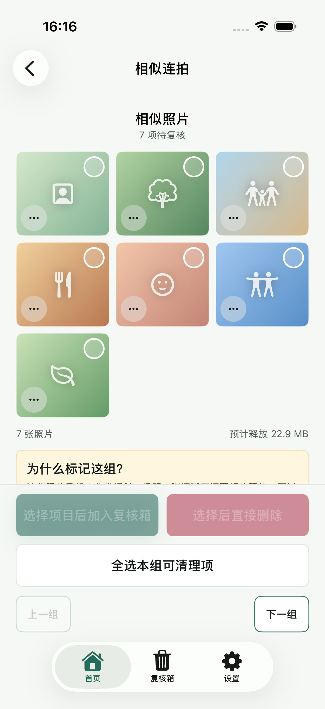

# 推荐保留关闭 E2E 证据

- 验证日期：2026-08-30
- 基线：`dev@e3312a6` 加本次未提交迭代
- 环境：Xcode 26.5，iPhone 17 Pro 模拟器，iOS 26.5（23F77）
- 红灯基线：5 个聚焦状态测试全部失败，共 9 条断言失败
- 聚焦状态绿灯：5/5 通过
- 单元测试目标：107/107 通过
- 推荐关闭 UI E2E：1/1 通过
- 已确认保留 UI 回归：1/1 通过，包含在完整结果包中
- 完整回归：140/140 通过（107 个单元测试、33 个 UI 测试），0 失败、0 跳过
- 推荐关闭结果包：`/tmp/TrueKeepDisableRecommendedUIRetry-20260830.xcresult`
- 完整结果包：`/tmp/TrueKeepDisableRecommendedFull-20260830.xcresult`
- 删除安全：所有测试都通过环境变量和 `-TrueKeepDisablePhotoDeletion` 禁用真实 Photos 删除

## 必要截图

| 阶段 | 截图 |
| --- | --- |
| 相似组初始零选择；没有推荐书签、推荐文案或推荐专属布局；两个删除入口禁用 |  |
| 用户主动选择原内部排名候选后，仅该照片显示选择状态，两个操作计数同步为 1 |  |

截图由 XCUITest 使用 `XCTAttachment` 和 `keepAlways` 生成。目检确认 7 张候选使用同层级三列网格，推荐保留语义完全不可见；初始态与主动选择态均无文字裁切、控件重叠或布局跳动。
