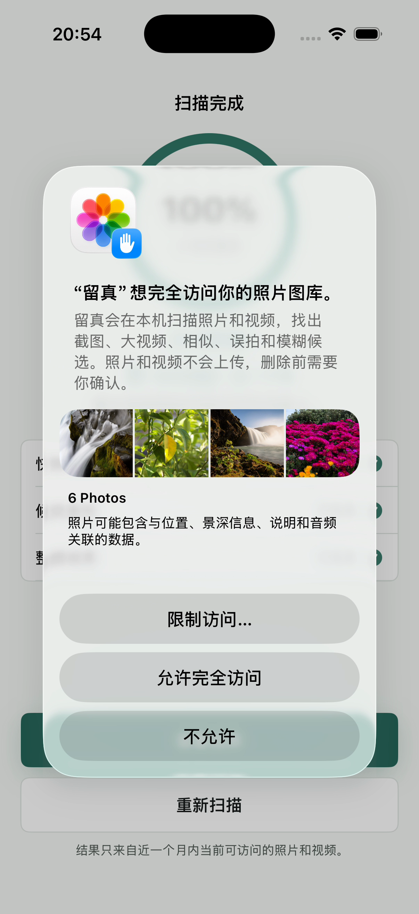

# 2026-10-09 模拟器安全回归

## 结果

- 环境：iPhone 17 Pro，iOS 26.5，arm64 模拟器。
- 完整应用与测试包构建通过；原 CoreSimulator／Preview 宏环境阻断已解除。
- 单元测试 101/101，通过；UI 测试 32/33，通过；总计 133/134，整体失败。
- 真实 Photos 删除禁用；截图内容为测试夹具，不能作为真实识别准确率或真机性能证据。
- 本次没有修改产品代码，没有提交、推送或安装到真机。

## 唯一失败

`TrueKeepUITests/testAuthorizedColdLaunchCanStartAndRepeatScanFromHome()` 在返回首页断言失败（`TrueKeepUITests.swift:728`）。日志明确出现系统“留真想完全访问你的照片图库”弹窗，点击被中断且没有 interruption monitor 处理。

用例通过启动参数模拟已授权状态，但根视图仍使用真实 `SystemPhotoLibraryScanner`，读取真实 Photos 时遇到模拟器尚未授予的权限。现有证据支持测试前置授权不一致；不能直接推出真实已授权场景功能失败。尚未改动权限状态或修复测试，需独立复测。



此图从该失败用例自动保存的录屏第 12 秒提取，并非重新摆拍。

## 关键截图

- [会话重启后恢复](screenshots/review-session-restored-after-relaunch.png)
- [会话重启前](screenshots/review-session-before-relaunch.png)
- [预览本地不可读取](screenshots/media-preview-local-unavailable.png)
- [更换推荐保留项](screenshots/review-user-keep-override.png)
- [整组保留](screenshots/review-entire-group-kept.png)
- [清除保留记录](screenshots/review-ignore-records-cleared.png)
- [扫描覆盖及本地不可读取](screenshots/scan-coverage-with-local-unavailable.png)
- [候选复核取消](screenshots/scan-candidate-refinement-cancelled.png)
- [大字号扫描范围选择](screenshots/home-scan-range-picker-accessibility-text.png)

`screenshots/` 保留 25 张原生命名附件及 1 张失败录屏提取图。原生命名附件使用 `XCTAttachment.keepAlways`。`attachments-manifest.json` 是原始导出映射；导出文件名 UUID 对应 xcresult 附件，截图另按可读名称保存。

## 原始证据

- `summary.json`：xcresult 原生汇总。
- `xcodebuild.log`：完整构建与测试日志。
- `FullRegression.xcresult`：本地完整测试报告（被 `.gitignore` 忽略，未随源码提交），含失败录屏及 UI 层级。

## 复现命令

```sh
TRUEKEEP_DISABLE_PHOTO_DELETION=1 xcodebuild test \
  -project iOS/TrueKeep/TrueKeep.xcodeproj -scheme TrueKeep \
  -destination 'platform=iOS Simulator,id=642F2F40-1DF5-4C73-A382-494BBE4C53AB' \
  -derivedDataPath /tmp/truekeep-full-20261009 \
  -resultBundlePath /tmp/truekeep-full-20261009.xcresult \
  -parallel-testing-enabled NO CODE_SIGNING_ALLOWED=NO
```

重跑时使用新的 resultBundlePath；设备 ID 仅适用于本机当前模拟器。

## 尚未完成

- 首次扫描用例权限前置条件修复与回归全绿。
- 实际照片／视频成功预览、缩放和播放验收。
- 权限变化、失效详情及取消重扫的专项验证补齐。
- 真实图库标注准确率、普通／低电量真机性能。
