# 留真页面交互设计审查

日期：2026-11-04，Asia/Shanghai。范围：当前 dev `2d05317` 加既有未提交的删除授权持久化改动。此前生成的复核页设计稿尚未实现，不是本次运行界面。

## 执行与证据边界

- iPhone 17 Pro / iOS 26.5 模拟器，原生 XCUITest 实际导航与截图。
- 5 条流程用例 + 1 条扫描覆盖报告用例全部通过；测试通过只说明指定操作/断言成功，不代表设计、真实图库识别或全量功能验收。
- 保留 20 张本轮 XCTest 命名附件（screenshots 中 19 张，coverage 中 1 张）及 1 张本轮 simctl 扫描完成截图。manifest.json 保留测试与附件对应关系。
- 所有运行均显式 `-TrueKeepDisablePhotoDeletion`。样例数据用于稳定页面状态；未执行真实删除，未改变已连接真机的配置。
- 移动镜像的托管 Appium 报 `Managed Appium executable is unavailable`，原生 Simulator.app 窗口也不可用，因此改用仓库原生 UI 自动化在实际启动的模拟器中执行。不宣称完成手动逐项点击。
- 项目引用的 user-action-contract 技能在当前目录不可用，采用项目既有的动作局部进度、取消和恢复规则。
- 此次未改业务代码或测试代码。只新增审查说明及截图，没有提交或推送。

## 总结

不是所有页面都有相同程度的按钮堆叠，但存在共同的层级问题：把信任说明、技术诊断、下一轮操作与当前主要任务同时展开。建议优先修复状态语义，再合并操作区，最后调整视觉样式。此次没有证据确认 P0 误删缺陷；以下 P1/P2 是本次设计迭代的相对优先级。

## 逐页审查

### 1. 首次引导与权限说明：可用，P2 精简

优点：授权前说明访问范围、本地处理和不自动删除，有“暂不”，没有强迫授权。

问题：同一屏重复出现“回忆在设备上”、本地处理条目、黄色授权说明和两个信任标签。文字说明与图标占用较多空间；“了解更多”与“暂不”做成同级描边按钮，增加了非核心操作的视觉重量。

建议：保留三项必要说明，合并重复本地承诺，主操作为“允许访问照片”，暂不和了解更多采用清晰的次级入口。不得通过精简省略授权前说明。

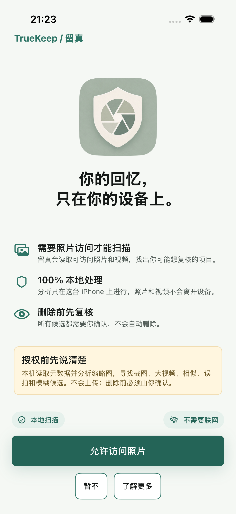

### 2. 首页结果与扫描中首页：P1 主次倒置

优点：任务按可理解类别分组，提供缩略图、数量和复核提示；扫描中可以返回浏览，不强制停留等待。

问题：完整报告状态下，分析数量、缓存数量、耗时、导出报告、分享提醒和“下次扫描范围”都先于候选任务显示；底部最显眼的是“重新扫描”。用户已经得到结果，页面却突出诊断和下一次扫描。扫描中首页同时有可点击的进度卡和底部“查看扫描进度”，入口重复。

建议：首页优先显示本次范围、简短覆盖摘要和候选任务。报告/导出进入“扫描详情”；下次扫描范围在用户发起重扫时选择；重扫保留易发现的工具栏入口。扫描中保留一个稳定的进度入口。不要删除必要的有限权限或未读取提醒，改为摘要和详情。

注意：marketing fixture 截图同时显示“需要照片访问”与样例候选，这是测试启动配置的组合，不能据此直接认定真实图库存在权限状态缺陷。

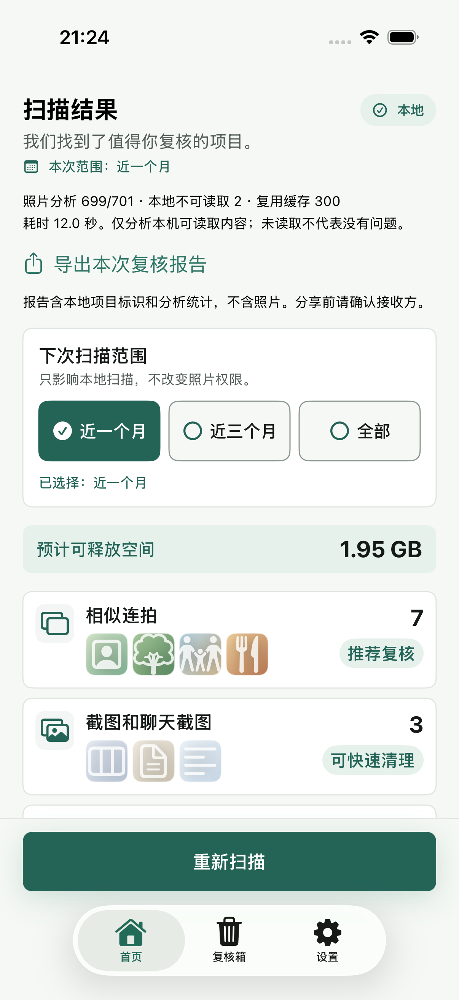
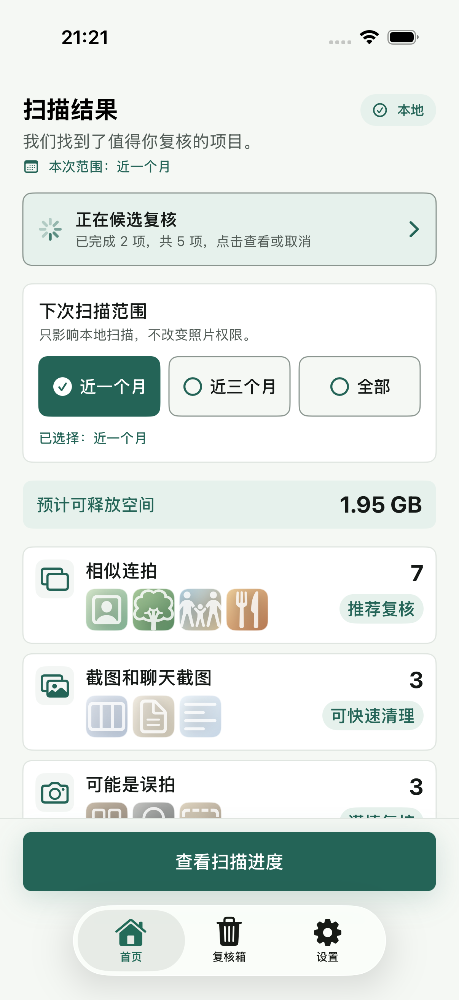

### 3. 截图与相似组复核：P1，共用布局问题

截图复核同样出现逐张“预览”、逐张更多菜单、加入复核箱、直接删除、全选、上一组/下一组和整组保留；不是相似照片单一分类的问题。主任务应是比较与选择，直接删除不宜与加入复核箱同等突出。

建议：复用前一轮已讨论的内容优先布局，但按照片数量、类型适配列数；统一点击图片预览、角标选择、紧凑分组导航和一个主要动作。保留直接删除二次确认。

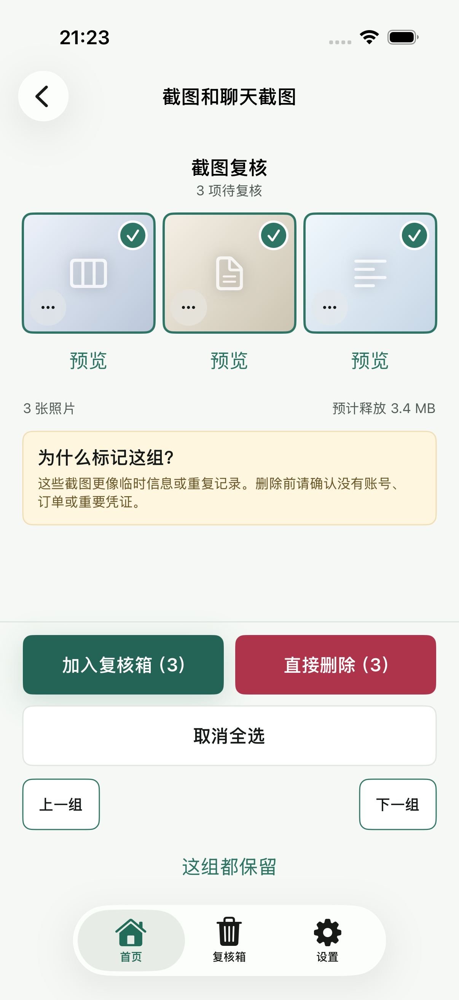

### 4. 全屏预览失败态：恢复路径可用，P2 层级调整

优点：提示本机不可读取，提供重试、下一张、关闭；不为预览下载 iCloud 原图。

问题：失败说明在黑色画布中央，下面仍有原因说明、上一张/下一张、保留动作和固定免责声明；黑白区域割裂，文字操作分散。内容尚未看清时“确认保留”与恢复动作并列，注意力容易分散。

建议：统一为内容浏览器；保持稳定的关闭、位置计数、前后导航和保留入口；失败时突出“重试/查看下一张”，原因和隐私说明降为按需详情。不要因本地不可读取而自动判为可删除。

边界：此截图为 fixture 没有真实资源导致的预期失败，不是发现真实图片加载 bug。成功照片预览、缩放、视频播放本轮未验收。

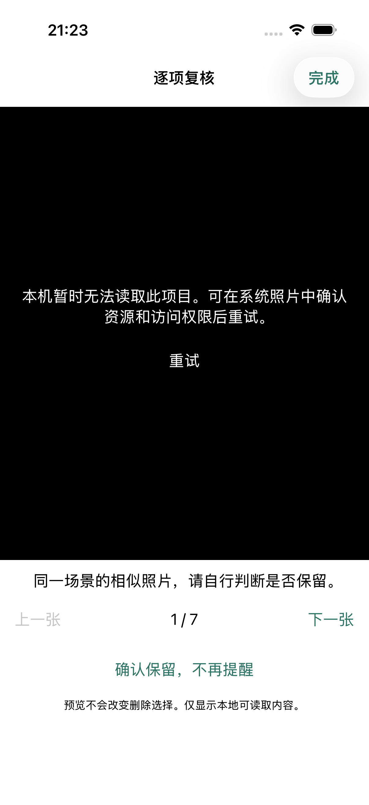

### 5. 复核箱：P1 语义风险，P2 信息重复

优点：已选数量和容量清楚；明确告知尚未删除，删除需要确认。

问题：上方“尚未删除任何内容”与下方“恢复选中”冲突，容易把复核箱误解为已删除列表。“复核箱项目仅本地保存 30 天”没有说明过期的是记录还是照片。顶部黄色提示、底部安全清单反复表达同一事实；每张照片独立“预览”继续占位。

代码核对：restoreSelectedReviewBinItems 只移除复核箱中的选中记录；SavedReviewSession.expireReviewBin 清理过期复核记录，不删除系统照片。因此可以准确改成“移出复核箱”，并说明“待删除记录保留 30 天，过期不会删除照片”。

建议：保留一行“尚未从系统相册删除”，详细安全说明按需展开；图片点击预览，选择状态清晰；移出与删除区分语义，删除保留危险样式和二次确认。中英文术语统一为“照片 App”“最近删除”。

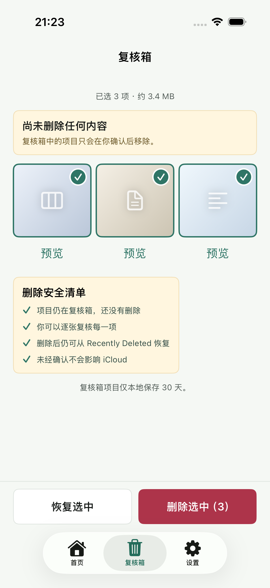

### 6. 删除二次确认：安全内容齐备，P2 呈现过重

优点：明确数量、系统相册删除、iCloud 同步影响及恢复信息，且有返回入口。

问题：只需数段内容却使用近全屏 sheet，大半屏空白；两个全宽大按钮放在上半部，视觉主导为红色删除。Recently Deleted、iCloud Photos 与中文混排，增加理解成本。

建议：内容驱动的系统确认 sheet，默认紧凑高度，大字号允许扩展和滚动。标题“删除这 3 项？”、简短影响说明、明确“取消/删除 3 项”；数量、iCloud 同步和最近删除提示不可省略。不要为了减少弹层取消二次确认。

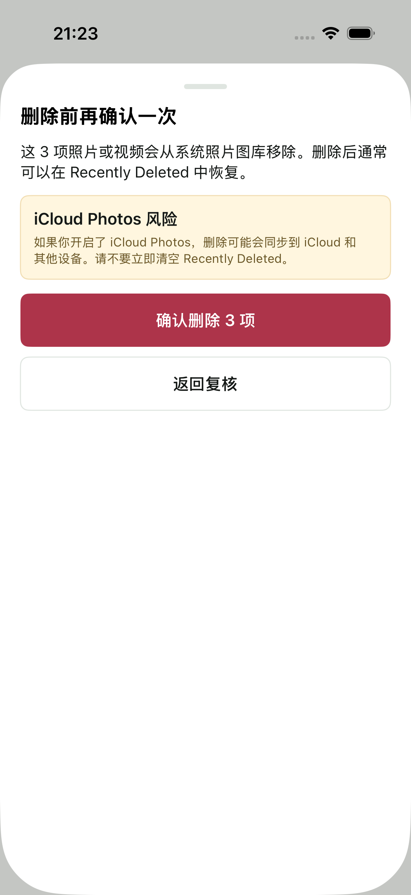

### 7. 设置与已确认保留：P1 可发现性，P2 重复操作

设置 Tab 打开后标题是“隐私与安全”，先展示整屏承诺、版本和 iCloud 说明，实际设置入口被放在下方；“本地模型实验”又排在“已确认保留”前面。对想管理照片的人来说，层级不符合使用目标。

建议：页面标题统一“设置”，先显示照片访问、已确认保留、扫描偏好等实际存在或经规格确认的设置；隐私承诺进入“隐私与安全”，模型实验归入高级/实验功能，不臆造尚不存在的控制项。

保留管理中只有 1 张时仍同时展示单项“取消保留”和整屏“全部取消保留”，且每项是“卡片套缩略图套按钮”。建议用图片网格/列表和统一选择工具栏；批量撤销置于编辑/更多，明确撤销的是保护记录，不是删除照片。

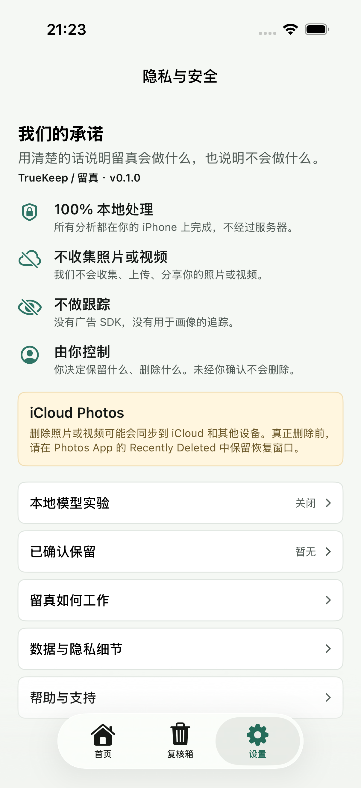
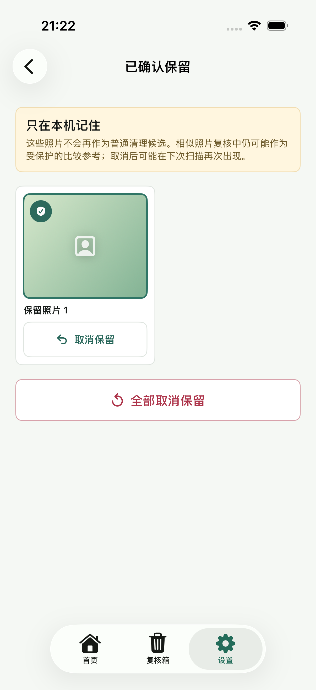

### 8. 扫描中、停止和完成：恢复可用，P2 冗余状态

扫描中同时有圆环、阶段列表和禁用的“扫描中…”按钮；后者既不能操作，又重复已有进度。停止后继续保留类似进度环和阶段表。完成后仍以 100% 圆环和历史过程为主体。

建议：扫描中保留一处进度及当前阶段，主动作可为“继续浏览”，取消为次级；移除伪操作形态的禁用状态按钮。完成后以结果摘要为主体，阶段明细折叠；保留明确“查看结果”，或者确认导航行为后直接进入结果。停止状态清楚区分“重新扫描”与“返回现有结果”。

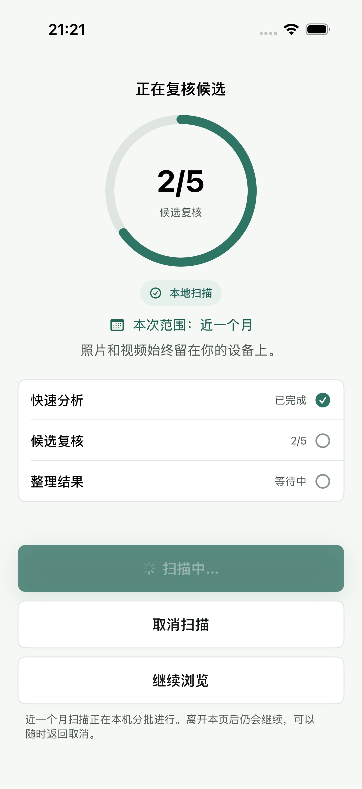
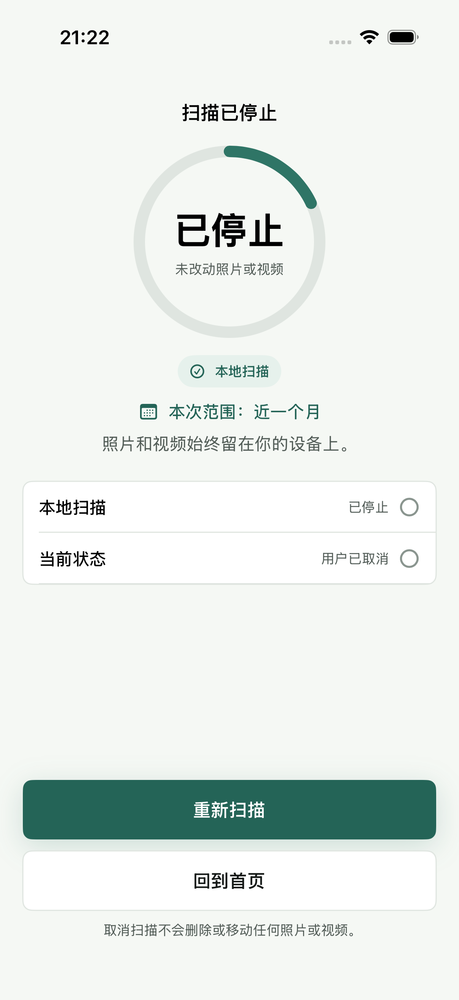
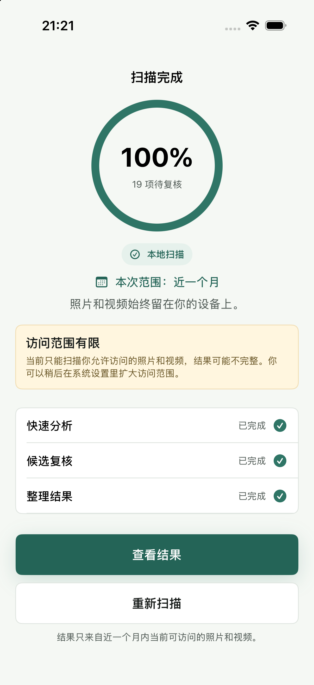

### 9. 空首页与保留空态：基本可用，P2 文案对齐

空首页仍标题为“扫描结果”，尚未扫描却使用偏成功感的勾选图标；权限提示和未扫描卡片重复解释。建议使用“开始整理”或状态相关标题、一个清晰的权限/扫描主动作和一段必要说明。

保留空态较清楚，但顶部仍常驻长黄色说明。可合并为简短空态说明；后续更改保留入口时同步修正“使用更多操作”的引导文案。

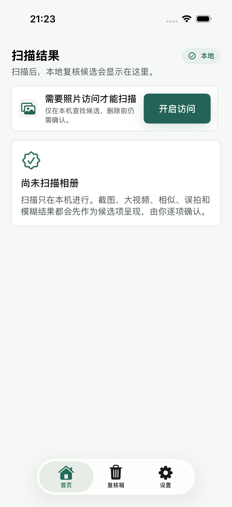
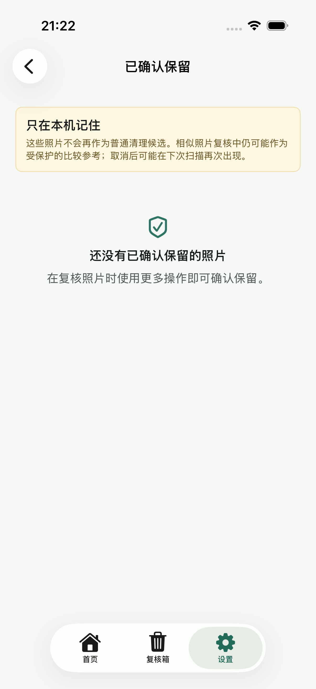

## 推荐实施顺序

1. 先统一复核组与复核箱：选择/预览约定、动作层级、保留与移出语义、30 天文案。保持真实删除确认及测试禁删边界。
2. 再调整首页与扫描：候选优先、范围配置归位、报告渐进展示、完成态简化。
3. 最后调整设置与首次引导：设置任务优先，隐私说明去重，实验功能降级。

这是审查建议，不是已实现方案。实施前补充 OpenSpec，且需要包含零选择、部分选择、失败/恢复、大字号和命名截图验收。

## 限制与待补验收

- 本轮不是完整可访问性审计；未重新测 VoiceOver 焦点/朗读顺序、对比度、大字号、横屏和小屏。
- 未验证成功图片预览、真实视频播放、真实相册权限变更、真实识别准确率及性能。
- 本地模型实验内部页面、帮助详情本轮没有新截图，不能宣称已经审查。
- review-second-similar-task-opened-from-home 附件底部不完整，不用于证明稳定态裁切缺陷；需要单独稳定态复测。
- 01-welcome 与 02-permission-rationale 来自同一合并引导状态，不能当作两个独立页面。

## Apple 原则依据

- [Designing for iOS](https://developer.apple.com/design/human-interface-guidelines/designing-for-ios)：让主要内容和任务突出，次要功能按需呈现。
- [Buttons](https://developer.apple.com/design/human-interface-guidelines/buttons)：突出动作数量有限，区分主要与破坏性动作。
- [Progress indicators](https://developer.apple.com/design/human-interface-guidelines/progress-indicators)：准确、一致的进度，完成后不再保留进行中的表现。
- [Alerts](https://developer.apple.com/design/human-interface-guidelines/alerts)：只呈现必要信息和有用操作。这里借用其简洁原则，不把当前 sheet 错称为系统 alert。

## 原始执行证据

- `/tmp/TrueKeepDesignAudit-20261104.xcresult` 与 `/tmp/TrueKeepDesignAudit-20261104.log`：5/5。
- `/tmp/TrueKeepDesignAuditCoverage-20261104.xcresult` 与 `/tmp/TrueKeepDesignAuditCoverage-20261104.log`：1/1。
- `screenshots/manifest.json`、`coverage/manifest.json`：按测试名映射实际命名附件。
- 使用已有当前缓存测试包 test-without-building，未为此次审查重新编译；未使用历史结果作为本次通过证明。
